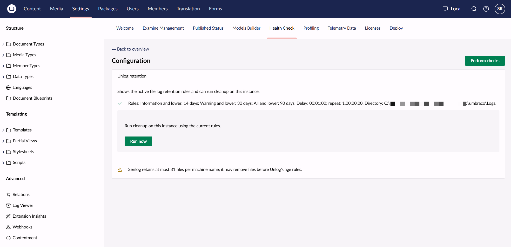

# Umbraco.Community.Unlog

Unlog removes old entries from Umbraco's own Serilog file logs. This repository contains the package source, tests, configuration schema, and release workflow. For installation and configuration, see the [NuGet guide](docs/nuget-readme.md). The [Marketplace guide](umbraco-marketplace-readme.md) is written for package users browsing Umbraco Marketplace.



## Repository layout

- `src/Umbraco.Community.Unlog/` contains the NuGet library and Umbraco integration.
- `tests/` contains automated tests.
- `docs/nuget-readme.md` is packed as the NuGet readme.
- `appsettings-schema.Umbraco.Community.Unlog.json` describes the `Umbraco:Community:Unlog` configuration section. The package registers it through `buildTransitive/Umbraco.Community.Unlog.targets` for Umbraco's combined appsettings schema and editors that support .NET JSON schema segments.
- `umbraco-marketplace.json` and `umbraco-marketplace-readme.md` supply Marketplace metadata and its separate user guide.
- `.github/workflows/publish.yml` publishes a tagged package to nuget.org.

## Develop locally

Use the .NET 11 SDK, including the release candidate while .NET 11 is in preview. Build the package project with:

```sh
dotnet build src/Umbraco.Community.Unlog/Umbraco.Community.Unlog.csproj
```

Before releasing, run the test suite and pack the library locally. Inspect the resulting `.nupkg` as a ZIP file to confirm it contains the readme, icon, schema, and `buildTransitive` target:

```sh
dotnet test
dotnet pack src/Umbraco.Community.Unlog/Umbraco.Community.Unlog.csproj -c Release -o ./artifacts
```

The cleanup code should treat log data as untrusted. Preserve the original file when an entry cannot be parsed or the file is in use, and keep changes to files atomic so a failed run cannot truncate a log.

## Test site

[`tests/Unlog.TestSite`](tests/Unlog.TestSite/README.md) runs Umbraco 19 RC with Clean Starter Kit and a project reference to Unlog. Use it to test the Health Check and recurring cleanup in a real site.

## Version lines and releases

The `main` branch targets Umbraco 19. The `v18/main` branch targets Umbraco 18, and `v17/main` targets Umbraco 17.

All branches publish the same package ID. Package versions `17.x.x` require Umbraco in `[17.0.0,18.0.0)`; `18.x.x` require `[18.0.0,19.0.0)`; `19.x.x` currently require `[19.0.0-rc1,20.0.0)`. Unlog `19.0.0-beta01` targets the Umbraco 19 release candidate. NuGet can report a dependency warning rather than reject installation when a consuming project directly overrides the Umbraco dependency range.

Push a tag such as `v17.0.0` from `v17/main`, `v18.0.0` from `v18/main`, or `v19.0.0-beta01` from `main`. The [publish workflow](.github/workflows/publish.yml) checks the tag, branch ancestry, package ID, version, and Umbraco dependency range before it publishes. Before the stable v19 release, raise the minimum Umbraco version to `19.0.0` in both the project and publish workflow. Do not reuse a version once nuget.org has accepted it.

The repository owner must configure a [nuget.org trusted publishing policy](https://learn.microsoft.com/en-us/nuget/nuget-org/trusted-publishing) with repository owner `skttl`, repository `umbraco-unlog`, workflow file `publish.yml`, and environment `release`. Create the `release` GitHub environment and set its `NUGET_USER` secret to the nuget.org account name that owns `Umbraco.Community.Unlog`. The workflow uses GitHub OIDC and a short-lived NuGet credential; it does not store a NuGet API key.

## License and icon

The source code is [MIT licensed](LICENSE). The package icon is ["File" by Mohamed Salah Hajji](https://thenounproject.com/icon/file-5074819/), supplied under a royalty-free license by the project owner.
